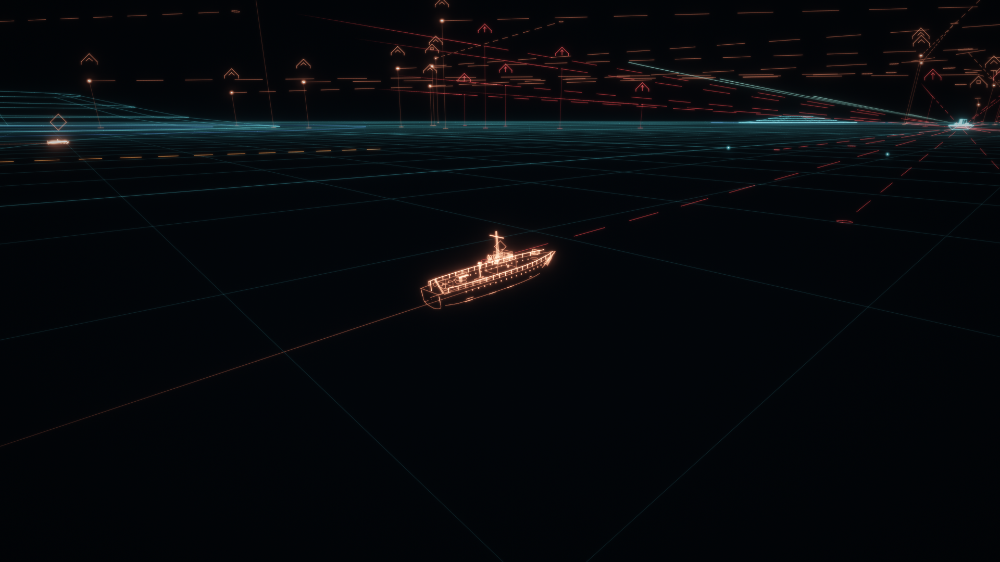
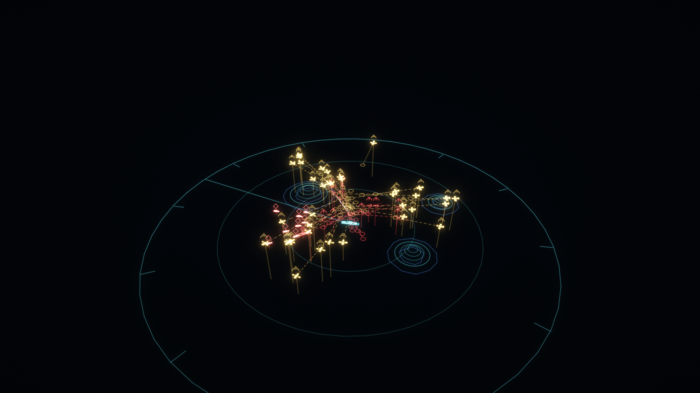

# Holo Tactical

A tactical hologram that redraws a battle from game data: a full-screen holographic reconstruction
(sea grid, contour-stacked islands, wireframes traced from the game's own models, wakes, tracks,
predicted paths, military-style map symbols) and a miniature hologram table you can zoom, pan and
pick on. Extracted from the *Theseus* naval game, made reusable through a small data **feed**
interface, so it fits any game that can list its contacts.

| Full-screen hologram | Hologram table |
|---|---|
|  |  |

## What is here

| Path | Contents |
|---|---|
| `SPEC.md` (`SPEC.ko.md` in Korean) | Engine-neutral spec: coordinates, feed data, look, symbols, wireframe tracing, contours, both views, glow, line dump, porting checklist |
| `godot/addons/holo_tactical/` | The Godot 4.7 implementation (GDScript). Copy this folder into a project |
| `godot/addons/holo_tactical/data/` | `palette.json` (colours and numbers) and `symbols.json`: the engine-neutral data |
| `godot/demo/` | A made-up battle feed and demo scene (primitive models), plus `trial.tscn`: the same battle with real game models (`demo/models/`) |
| `godot/tools/capture_demo.gd` | Runs a demo without a window and dumps the hologram lines |
| `reference/python/` | Reference implementations: `holo_edges.py` (feature edges), `holo_contours.py` (contours), `holo_render.py` (line dump to PNG) |
| `shaders/holo_glow.glsl` | The glow post-process as plain GLSL ES 3.0, for other engines |

## Requirements

- Godot **4.7** or newer (the project uses the Compatibility renderer; Forward+ works too).
- For the reference scripts: Python 3.10+ with `pip install -r reference/python/requirements.txt`.

## Try it

Open `godot/project.godot` in Godot (Import, then Run), or from a shell:

```bash
godot --path godot
```

The main scene is the primitive-model demo. For the trial run with game models, open
`demo/trial.tscn` and press F6, or run:

```bash
godot --path godot res://demo/trial.tscn
```

Controls:

- **1 / 2 / 3:** full-screen hologram, table, plain view
- **Right-drag:** turn the camera
- **Wheel:** zoom (on the table: step its range)
- **Tab:** follow the next contact (Shift+Tab: back to the own ship)
- **On the table:** left-drag slides the view, click picks, middle click recentres
- **Space:** pause

Headless capture (no window, no GPU needed):

```bash
godot --headless --path godot --fixed-fps 60 --script res://tools/capture_demo.gd -- --scene=trial
python reference/python/holo_render.py out out/png
```

`godot` stands for your Godot 4.7 executable (on Windows the `_console.exe` build for headless runs).

## Use it in a Godot project

1. Copy `godot/addons/holo_tactical/` to `res://addons/holo_tactical/` in your project. The path is
   fixed.
2. Write a feed by extending `holo_feed.gd`, mapping your simulation onto `contacts()`, `origin()`
   and the rest (SPEC section 2). Give contacts a `node` and `model_key` to have your models traced
   into wireframes. `demo/demo_feed.gd` is a complete example.
3. Full-screen hologram:

```gdscript
var holo := preload("res://addons/holo_tactical/holo_world.gd").new()
world_3d.add_child(holo)
holo.setup(feed)
holo.set_active(true, camera, environment)   # false to take it down
# every frame: holo.update(delta)
# glow: a ShaderMaterial with holo_glow.gdshader on the SubViewportContainer showing the 3D view
```

4. Table:

```gdscript
var table := preload("res://addons/holo_tactical/holo_table.gd").new()
table_top.add_child(table)                     # middle of the table top, +X is "ahead"
table.setup(feed)
table.acted.connect(func(kind, at, inward): pass)   # zoom / pan / pick / center: animate your crew
# every frame: table.update(delta, someone_is_watching)
# working it: table_hit, step_range, begin_drag / drag_to / end_drag, pick, recenter
```

5. If your models carry parts that are not their shape (interiors, decals), list their node name
   prefixes in `holo_wireframe.gd`'s `skip_names`.

More detail on each script is in `godot/addons/holo_tactical/README.md`.

## Porting to another engine

Follow `SPEC.md` section 12. Keep the data files and the dump format as they are, port the
algorithms from `reference/python/` (each has a `--self-test`), and use `shaders/holo_glow.glsl`
for the glow. The Godot addon shows how the parts fit together.

## Models

`godot/demo/models/` holds six models from the Theseus project, used by the trial scene: a torpedo
boat, patrol boat and missile boat, and a small bomber, small torpedo bomber and rocket fighter. They
are self-contained glTF binaries with flat colours. See `godot/demo/models/README.md`.

## Licence

Free to use, change and share in any project, commercial or not, as long as you credit it:
"Holo Tactical by Choi (github.com/nroc0407)".

- Code: [MIT](LICENSE)
- Models, images, documentation and data: [CC BY 4.0](LICENSE-ASSETS)

---

## 한국어 요약

게임 데이터로 전장을 다시 그리는 전술 홀로그램 모듈입니다. 전함 테세우스에서 떼어 냈습니다.

- **두 가지 뷰:** 전체화면 홀로그램 재구성과, 확대·관측 이동·선택이 되는 미니어처 홀로그램 탁자.
- **게임 연결 방식:** 게임은 '피드' 하나만 구현하면 됩니다. 피드는 접촉 목록, 기준 위치, 궤적, 폭발, 지형선을 넘겨주는 인터페이스입니다.
- **사용법:** Godot 프로젝트에는 `godot/addons/holo_tactical/` 폴더를 복사해 넣습니다. 다른 엔진은 `SPEC.ko.md`(한국어 사양)와 `reference/python`을 기준으로 옮깁니다.
- **데모:** `godot --path godot`으로 실행합니다. 테세우스 소형정·소형 항공기 모델을 쓰는 시험가동 씬은 `demo/trial.tscn`입니다.
- **라이선스:** 출처만 표시하면 상업적 용도를 포함해 자유롭게 쓰고, 고치고, 배포할 수 있습니다. 코드는 MIT, 모델·이미지·문서·데이터는 CC BY 4.0입니다.
